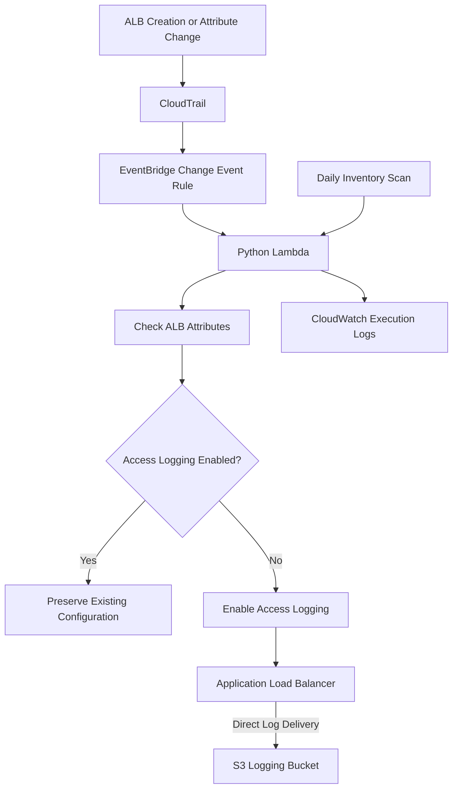
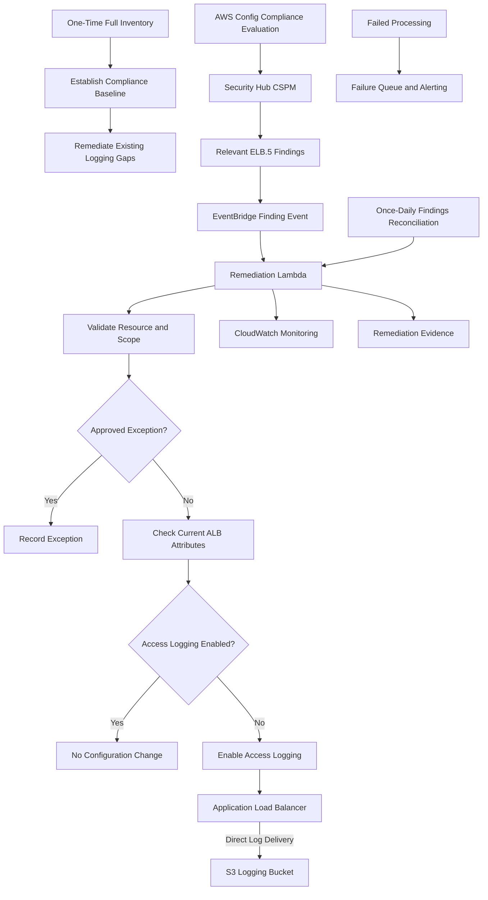
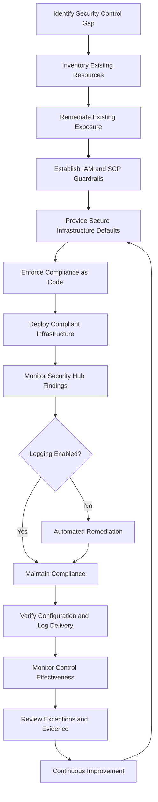

# AWS ALB Access Logging Guardrail

### Protecting Visibility Across Ad Sales Applications and Partner Integrations

Ad Sales environments depend on applications, APIs, and integrations that support advertising operations and connectivity with external partners. When these services experience disruptions, unexpected traffic, or potential security incidents, having visibility into incoming requests is critical to understanding what happened and supporting an effective investigation.

Application Load Balancer (ALB) access logs provide valuable request-level visibility into traffic reaching these services. They can help security and engineering teams:

- Investigate suspicious activity targeting internet-facing applications.
- Troubleshoot partner-reported integration issues.
- Identify unexpected traffic patterns and elevated response times.
- Distinguish load balancer errors from backend application failures.
- Support incident investigations with request-level context.
- Correlate suspicious requests with other security telemetry.
- Support collaboration between security, engineering, and product teams.

To address the need for consistent visibility into application traffic, this project demonstrates a security guardrail built around four key objectives:

## Project Objectives

| Security Objective | Implementation |
|---|---|
| **Establish Visibility** | Enable ALB access logging to support security investigations, traffic analysis, and application troubleshooting. |
| **Prevent Configuration Drift** | Use infrastructure as code, preventive guardrails, and automated remediation to maintain required logging configurations. |
| **Detect Configuration Changes** | Monitor infrastructure changes and leverage Security Hub findings to identify logging gaps. |
| **Support Operational Accountability** | Establish a foundation for monitoring, exception handling, developer enablement, and ongoing security control ownership. |


---

## Table of Contents

- [Business Context](#business-context)
- [Technical Implementation](#technical-implementation)
- [Architecture](#architecture)
- [How Remediation Works](#how-remediation-works)
- [Proposed Security Hub Integration](#proposed-security-hub-integration)
- [Engineering Design Decisions](#engineering-design-decisions)
- [Proof of Concept Status](#proof-of-concept-status)
- [Testing and Validation](#testing-and-validation)
- [End-to-End Security Control Lifecycle](#end-to-end-security-control-lifecycle)
- [Security Across the SDLC](#security-across-the-sdlc)
- [Organizational Guardrails](#organizational-guardrails)
- [Compliance as Code](#compliance-as-code)
- [Developer and Product Engagement](#developer-and-product-engagement)
- [Security of the Security Control](#security-of-the-security-control)
- [Production Hardening](#production-hardening)
- [Enterprise Rollout Strategy](#enterprise-rollout-strategy)
- [Cost Considerations](#cost-considerations)
- [Ad Sales Security Knowledge Base](#ad-sales-security-knowledge-base)
- [Operational Ownership](#operational-ownership)
- [Measuring Control Effectiveness](#measuring-control-effectiveness)
- [Success Criteria](#success-criteria)
- [Business and Security Outcomes](#business-and-security-outcomes)

---

## Business Context

Ad Sales applications may depend on internet-facing APIs, advertising platforms, internal services, and integrations with external business partners.

Without consistent access logging, security and engineering teams may have limited visibility when investigating application failures, suspicious activity, or partner-reported issues.

The following scenarios illustrate how ALB access logging could support an Ad Sales environment.

| Illustrative Business Scenario | Value of ALB Access Logging |
|---|---|
| External advertising partner reports API failures | Investigate request paths, response codes, and processing times. |
| Unexpected increase in application traffic | Identify traffic patterns and source addresses. |
| Advertising campaign-related traffic surge | Investigate elevated latency and load balancer errors. |
| Potential unauthorized API activity | Correlate suspicious requests with authentication and application logs. |
| Application availability incident | Distinguish load balancer-generated errors from backend application responses. |
| Partner integration disruption | Provide request-level context to support troubleshooting. |
| Potential application-layer attack | Correlate request patterns with AWS WAF and other security telemetry. |

Access logging provides value beyond security investigations. It can also support application reliability, engineering troubleshooting, and collaboration with business partners.

ALB access logs are a best-effort source of telemetry and should complement, rather than replace, application, authentication, WAF, and other security logs.

---

## Technical Implementation

The current proof of concept uses Terraform and Python to deploy an AWS-native security guardrail.

| Component | Purpose |
|---|---|
| **Terraform** | Defines repeatable, version-controlled security infrastructure. |
| **Python Lambda** | Checks ALB attributes and enables access logging when disabled. |
| **Amazon S3** | Receives access logs from remediated ALBs. |
| **Amazon EventBridge** | Routes relevant load balancer creation and attribute-change events to Lambda. |
| **Scheduled EventBridge Rule** | Runs a daily inventory scan to identify existing resources and missed changes. |
| **AWS CloudTrail** | Provides visibility into relevant AWS API activity. |
| **AWS IAM** | Grants discovery, remediation, and execution permissions. |
| **Amazon CloudWatch Logs** | Retains Lambda execution logs for 90 days. |

The module is scoped to an individual AWS account and Region.

Organization-wide adoption would require an approved multi-account deployment mechanism and coordination with cloud platform engineering teams.

The event-driven implementation depends on appropriately configured CloudTrail management events. The current Terraform implementation does not provision CloudTrail.

---

## Architecture

### Current Proof of Concept



The architecture combines event-driven detection with scheduled inventory reconciliation.

The event-driven path is intended to reduce the amount of time a resource remains noncompliant following creation or a configuration change.

The scheduled scan provides a secondary mechanism for identifying existing logging gaps and missed events.

> **Important:** Lambda configures access logging. The Application Load Balancer delivers access logs directly to S3.

The diagram represents the intended proof-of-concept architecture. Event-driven remediation and actual access-log delivery require additional validation.

---

## How Remediation Works

- Existing ALBs with logging disabled are configured to use the module's S3 logging destination.
- ALBs already logging are left unchanged, including their existing logging destination.
- Newly created ALBs are intended to be remediated through the event-driven path.
- Repeated processing should make no changes when logging is already enabled.
- Execution information is recorded in CloudWatch Logs.
- The module operates within the deployed AWS account and Region.

### Remediation Workflow

1. Identify the affected load balancer.
2. Retrieve its current attributes.
3. Determine whether access logging is enabled.
4. If logging is disabled, configure the approved logging destination.
5. Enable access logging.
6. Record the remediation result.
7. Verify the resulting configuration.

### Current Control Boundaries

- The current implementation checks whether logging is enabled.
- Existing enabled logging destinations are preserved.
- Existing destinations are not validated against an organizational standard.
- Runtime remediation is corrective rather than instantaneous prevention.
- Requests occurring during a logging gap cannot be retroactively recovered.
- Formal exception handling remains a production requirement.
- Successful configuration changes do not independently establish successful log delivery.

---

## Proposed Security Hub Integration

The proof of concept demonstrates a standalone mechanism for detecting and remediating disabled ALB access logging.

In an enterprise environment, I would first evaluate whether AWS Security Hub CSPM is already deployed and capable of providing the required compliance findings.

Rather than repeatedly scanning every load balancer, the proposed production architecture would leverage existing security findings as the primary input for targeted remediation.

### Initial Inventory and Remediation

Perform a one-time inventory across approved AWS accounts and Regions.

The initial inventory would:

- Identify existing ALBs.
- Identify resources with disabled access logging.
- Review existing logging destinations.
- Identify application and infrastructure owners.
- Establish an initial compliance baseline.
- Remediate eligible noncompliant resources.
- Identify resources requiring documented exceptions.

This establishes a starting point for ongoing compliance.

### Findings-Driven Remediation

AWS Security Hub CSPM control `ELB.5` evaluates whether Application and Classic Load Balancers have logging enabled.

The proposed automation would filter findings to include only in-scope Application Load Balancers.

Relevant findings would be routed through EventBridge to the remediation Lambda.

Before modifying a resource, Lambda would:

1. Validate the finding and originating account.
2. Confirm the resource is an Application Load Balancer.
3. Check whether the resource is within the approved remediation scope.
4. Check for applicable exceptions.
5. Retrieve the current resource configuration.
6. Remediate the resource only if logging remains disabled.
7. Record the remediation result.
8. Allow the underlying compliance evaluation to verify the resulting state.

Rechecking the live resource configuration helps prevent unnecessary changes caused by stale or duplicate findings.

### Once-Daily Findings Reconciliation

Run a scheduled reconciliation once daily to review outstanding relevant Security Hub findings.

The reconciliation would:

- Identify outstanding noncompliant ALBs.
- Recover findings missed by event-driven processing.
- Retry eligible remediation failures.
- Identify unresolved findings requiring manual investigation.
- Produce evidence that the control continues to operate.

The daily reconciliation would query relevant findings rather than perform a complete inventory of every load balancer.

Periodic independent inventory reviews may still be appropriate to validate Security Hub coverage and identify resources outside the expected monitoring scope.

### Proposed Production Architecture



### Security Hub Integration Considerations

- Confirm Security Hub CSPM and required AWS Config recording are enabled for in-scope resources.
- Confirm that relevant findings are generated across approved accounts and Regions.
- Account for finding evaluation latency.
- Filter out archived, resolved, and out-of-scope findings as appropriate.
- Validate resource types before remediation.
- Handle duplicate and stale findings safely.
- Support pagination when querying findings.
- Account for cross-account remediation permissions.
- Avoid treating a successful Lambda invocation as proof of compliance.
- Verify actual access-log delivery independently.

A direct CloudTrail event-driven path could also be retained if the business requires faster remediation than findings-based evaluation can provide.

> **Implementation Status:** Security Hub integration represents a proposed production enhancement. It has not been implemented or validated as part of the current proof of concept.

---

## Engineering Design Decisions

| Design Decision | Rationale |
|---|---|
| **Infrastructure as Code** | Provides repeatable deployments, version-controlled infrastructure, and auditable configuration changes. |
| **Serverless Automation** | Reduces the operational overhead associated with dedicated compute infrastructure. |
| **One-Time Initial Inventory** | Establishes an initial compliance baseline and addresses existing logging gaps. |
| **Findings-Driven Remediation** | Leverages existing security findings to target noncompliant resources. |
| **Once-Daily Reconciliation** | Provides a secondary mechanism for recovering missed findings and unresolved remediation failures. |
| **Idempotent Remediation** | Avoids unnecessary configuration changes when resources are already compliant. |
| **Existing Destination Preservation** | Reduces disruption to established application logging workflows. |
| **Account and Region Isolation** | Supports incremental rollout and limits operational blast radius. |
| **AWS-Native Services** | Reduces additional infrastructure and operational dependencies. |

The proposed architecture balances security effectiveness, remediation latency, operational reliability, developer experience, and cost.

### Alternative Approaches

Before introducing custom automation into a production environment, evaluate existing organizational capabilities.

Potential alternatives include:

- AWS Config managed rules such as `ELB_LOGGING_ENABLED`.
- AWS Config automated remediation.
- AWS Security Hub CSPM findings.
- Existing cloud security posture management platforms.
- Existing enterprise remediation frameworks.
- Approved Terraform modules and policy-as-code platforms.

The objective is not to introduce additional tooling unnecessarily.

Where existing enterprise capabilities meet the security requirement, they should be leveraged before introducing custom infrastructure.

---

## Proof of Concept Status

This repository should be treated as an independently developed **proof of concept**, not a production-certified security control.

### Validated

- [x] Manual Lambda invocation successfully exercised the inventory scan path.

### Required Before Production

- [ ] Verify the deployed handler correctly parses real CloudTrail events.
- [ ] Validate automatic remediation for newly created ALBs.
- [ ] Validate remediation after logging is disabled.
- [ ] Confirm idempotent remediation behavior.
- [ ] Confirm existing compliant destinations are preserved.
- [ ] Confirm actual access-log delivery to S3.
- [ ] Validate scheduled inventory reconciliation.
- [ ] Add failure destinations and operational alerting.
- [ ] Test permissions, retries, and execution duration.
- [ ] Validate Security Hub findings-driven remediation.
- [ ] Validate once-daily findings reconciliation.
- [ ] Establish formal exception handling.
- [ ] Complete a staged rollout with documented ownership and rollback.

> A successful manual inventory scan does not establish that the event-driven remediation path, Security Hub integration, or actual log delivery has been validated.

---

## Testing and Validation

| Test Scenario | Expected Outcome | Status |
|---|---|---|
| Manual inventory scan | Lambda successfully exercises the scan path. | Exercised |
| Existing noncompliant ALB | Access logging becomes enabled. | Pending |
| Newly created ALB | Automatic remediation enables logging without manual invocation. | Pending |
| Logging disabled | Required logging configuration is restored. | Pending |
| Already compliant ALB | Existing configuration remains unchanged. | Pending |
| Repeated invocation | No unnecessary modifications occur. | Pending |
| Access-log delivery | Approved test requests produce log objects in S3. | Pending |
| Security Hub finding | Relevant noncompliant finding triggers targeted remediation. | Planned |
| Stale or duplicate finding | Live configuration is checked before modification. | Planned |
| Daily reconciliation | Outstanding eligible findings are identified and processed. | Planned |
| Permission failure | Failure is observable and recoverable. | Planned |
| Approved exception | Resource is excluded and exception evidence is recorded. | Planned |
| Large resource inventory | Processing completes within established execution limits. | Pending |

### Validation Principles

- Use isolated and disposable test resources.
- Separate manual remediation tests from event-driven tests.
- Correlate CloudTrail, EventBridge, Lambda, and resource configuration timestamps.
- Verify actual access-log delivery independently from configuration changes.
- Validate that existing compliant resources are not unnecessarily modified.
- Confirm that failure scenarios produce actionable operational alerts.
- Document test evidence, limitations, and outstanding requirements.

> Enabling the access-logging attribute and confirming successful log delivery are separate validation requirements.

---

## End-to-End Security Control Lifecycle

The objective is not simply to enable load balancer access logging.

The objective is to demonstrate how an individual security requirement can be addressed across the entire security control lifecycle.

This includes containing existing exposure, preventing the introduction of new noncompliant infrastructure, detecting configuration drift, automating remediation, and maintaining operational accountability.



| Lifecycle Phase | Security Objective | Approach |
|---|---|---|
| **Identify** | Understand existing exposure and business impact. | Inventory and security findings. |
| **Contain** | Address existing logging gaps. | Initial remediation. |
| **Restrict** | Reduce unauthorized infrastructure modifications. | IAM and SCP guardrails. |
| **Prevent** | Avoid introducing new logging gaps. | Secure Terraform defaults. |
| **Validate** | Identify noncompliance before deployment. | Compliance as code. |
| **Detect** | Identify runtime configuration drift. | Security Hub and CloudTrail. |
| **Correct** | Restore required configurations. | Automated Lambda remediation. |
| **Protect** | Secure the remediation infrastructure itself. | Least privilege and change restrictions. |
| **Verify** | Establish evidence that the control works. | Monitoring and log-delivery validation. |
| **Sustain** | Maintain long-term control effectiveness. | Documentation, ownership, and exceptions. |

---

## Security Across the SDLC

This approach combines preventive, detective, and corrective controls throughout the software development lifecycle.

| SDLC Stage | Security Approach | Control Type |
|---|---|---|
| **Design** | Define logging requirements, approved destinations, retention, and ownership. | Preventive |
| **Development** | Provide approved Terraform modules with access logging enabled by default. | Preventive |
| **Pull Request** | Evaluate infrastructure changes using compliance-as-code checks. | Preventive |
| **Deployment** | Require approved deployment roles and reviewed infrastructure plans. | Preventive |
| **Runtime** | Detect noncompliant configurations through security findings and infrastructure events. | Detective |
| **Remediation** | Automatically correct eligible logging gaps. | Corrective |
| **Operations** | Monitor failures, review exceptions, and maintain control evidence. | Detective |

### 1. Stop the Bleeding

The initial priority is to understand and address existing exposure while reducing the likelihood of additional noncompliant configurations.

Begin by performing a one-time inventory across approved accounts and Regions.

Identify:

- Existing ALBs with disabled access logging.
- Existing logging destinations.
- Application and infrastructure owners.
- Approved security exceptions.
- Infrastructure deployment workflows.
- Direct console, CLI, SDK, and programmatic access paths.

Validate destination permissions and operational requirements before enabling automated remediation.

Correcting existing resources alone does not prevent the same configuration from being reintroduced.

### 2. Make Secure Provisioning the Default

Work with platform engineering and application teams to update shared Terraform modules so that ALB access logging is enabled at resource creation.

An illustrative Terraform configuration is shown below.

```hcl
resource "aws_lb" "application" {
  name               = "application-alb"
  internal           = false
  load_balancer_type = "application"

  subnets         = var.subnet_ids
  security_groups = var.security_group_ids

  access_logs {
    bucket  = var.approved_logging_bucket
    prefix  = "alb-access"
    enabled = true
  }
}
```

This example assumes the logging bucket and required delivery permissions have already been established.

Providing approved infrastructure patterns reduces the burden on application teams and helps prevent conflicts between infrastructure deployments and runtime remediation.

The objective is to make the secure deployment path the easiest deployment path.

### 3. Prevent New Noncompliant Changes

Introduce compliance-as-code checks within infrastructure CI/CD pipelines.

Noncompliant infrastructure should be identified before changes are merged or deployed.

Developers should receive actionable feedback explaining the security requirement and how to resolve the issue.

### 4. Detect and Correct Runtime Drift

Preventive controls do not cover every possible infrastructure change path.

Resources may still be introduced or modified through direct AWS access, existing automation, or approved deployment roles.

Runtime detection and remediation provide an additional layer of protection.

Security Hub findings, infrastructure events, and scheduled reconciliation can identify and correct eligible noncompliant resources.

### 5. Sustain the Security Control

Establish ongoing monitoring, documented ownership, developer guidance, exception handling, and measurable control effectiveness.

Security requirements should remain part of the application lifecycle rather than being treated as a one-time remediation exercise.

---

## Organizational Guardrails

Infrastructure security checks within CI/CD pipelines do not address every possible infrastructure change path.

Developers and automation may also modify AWS resources through:

- AWS Management Console.
- AWS CLI.
- AWS SDKs.
- Programmatic access.
- Infrastructure deployment roles.
- Other automation platforms.

Without appropriate IAM and organizational guardrails, these access paths may introduce the same configuration risks that pipeline checks are intended to prevent.

### Restrict ALB Attribute Modification

Review IAM permissions to identify users, roles, and automation capable of modifying load balancer attributes.

Where appropriate, restrict these permissions to:

- Approved infrastructure deployment roles.
- Approved remediation roles.
- Authorized platform engineering roles.
- Controlled emergency access roles.

### Illustrative Service Control Policy

An AWS Organizations Service Control Policy could restrict ALB attribute modifications to approved roles.

```json
{
  "Version": "2012-10-17",
  "Statement": [
    {
      "Sid": "RestrictALBAttributeModification",
      "Effect": "Deny",
      "Action": "elasticloadbalancing:ModifyLoadBalancerAttributes",
      "Resource": "arn:aws:elasticloadbalancing:*:*:loadbalancer/app/*",
      "Condition": {
        "ArnNotLike": {
          "aws:PrincipalArn": [
            "arn:aws:iam::*:role/ApprovedInfrastructureDeploymentRole",
            "arn:aws:iam::*:role/ALBLoggingRemediationRole",
            "arn:aws:iam::*:role/ApprovedEmergencyAccessRole"
          ]
        }
      }
    }
  ]
}
```

This illustrative SCP restricts ALB attribute modifications to approved roles.

It does not grant permissions to those roles. Appropriate IAM permissions are still required.

### SCP Limitations

- An SCP cannot selectively inspect `access_logs.s3.enabled` to deny only attempts to disable access logging.
- Restricting `ModifyLoadBalancerAttributes` also restricts modifications to other ALB attributes.
- Approved roles may still introduce logging drift.
- The SCP does not guarantee that access logging is enabled at resource creation.
- AWS Organizations management accounts and service-linked roles are not restricted by SCPs.
- Approved role creation, modification, and assumption must be appropriately protected.
- Existing application and automation dependencies must be evaluated before enforcement.

The SCP should be tested within a controlled environment before being applied to production organizational units.

> **Implementation Status:** This policy is an illustrative production guardrail. It has not been deployed or validated as part of the proof of concept.

---

## Compliance as Code

Runtime remediation addresses existing infrastructure and configuration drift.

Preventive security controls should also be integrated into infrastructure development and deployment workflows.

A proposed approach is to use Checkov within GitHub Actions to identify noncompliant Terraform configurations.

Checkov policy `CKV_AWS_91` provides a starting point for evaluating ELBv2 access-logging configurations.

### Illustrative GitHub Actions Workflow

**File:** `.github/workflows/infrastructure-security.yml`

```yaml
name: Infrastructure Security

on:
  pull_request:
  push:
    branches:
      - main

permissions:
  contents: read

jobs:
  infrastructure-compliance:
    name: ALB Logging Compliance
    runs-on: ubuntu-latest

    steps:
      - name: Checkout Repository
        uses: actions/checkout@v4

      - name: Check ALB Logging Configuration
        uses: bridgecrewio/checkov-action@master
        with:
          directory: .
          framework: terraform
          check: CKV_AWS_91
          soft_fail: false
```

This illustrative workflow evaluates Terraform configurations against the selected access-logging policy.

Noncompliant configurations cause the security check to fail.

The action references above are illustrative. Production implementations should use reviewed, immutable commit SHAs rather than mutable branches or version tags.

### Proposed Developer Feedback

When a noncompliant configuration is identified, developers should receive guidance explaining:

- Which infrastructure resource failed the policy.
- Why ALB access logging is required.
- How to enable access logging.
- Which logging destinations are approved.
- Where to find compliant infrastructure examples.
- How to request an exception when necessary.

### Enforcement Requirements

- Configure the security check as a required status check.
- Prevent merging pull requests when the required check fails.
- Protect workflow and policy configuration files.
- Require review of policy suppressions.
- Use reviewed and pinned dependencies.
- Validate Terraform plans where appropriate.
- Extend baseline policies to validate approved logging destinations.
- Retain evidence of security policy evaluations.

GitHub Actions checks can help prevent noncompliant infrastructure from being introduced through approved repositories.

However, pipeline checks do not independently prevent direct infrastructure changes within AWS.

Runtime detection and remediation remain necessary.

> **Implementation Status:** This workflow represents a proposed preventive control. It has not been validated as part of the current proof of concept.

---

## Developer and Product Engagement

Successful security engineering requires collaboration with the teams responsible for developing, deploying, and operating business-critical applications.

Before introducing enforcement, engage developers, platform engineers, and Ad Sales product owners to understand:

- Existing application architectures.
- Infrastructure deployment processes.
- External partner integrations.
- Existing logging and troubleshooting capabilities.
- Operational dependencies.
- Application availability requirements.
- Logging retention and access requirements.
- Potential business impact of security enforcement.

### Developer Experience

Security requirements should be supported through:

- Approved Terraform modules.
- Secure infrastructure defaults.
- Actionable CI/CD security feedback.
- Examples of compliant infrastructure.
- Clear documentation explaining security requirements.
- Accessible security engineering support.
- A documented exception process.

The objective is to reduce unnecessary friction while helping developers understand both the security requirement and its operational value.

### Product and Business Alignment

Position access logging as both a security and operational capability.

The same telemetry used during security investigations can also help application teams troubleshoot partner integration failures, unexpected traffic, elevated response times, and application errors.

This creates an opportunity to align security improvements with the operational needs of Ad Sales.

Security engineering should support business objectives rather than operate independently of them.

---

## Security of the Security Control

The remediation infrastructure must itself be protected against unauthorized modification, disablement, and misuse.

| Protected Component | Proposed Security Requirement |
|---|---|
| **Lambda Code** | Restrict code updates to approved deployment roles. |
| **Lambda Configuration** | Restrict changes to environment variables and execution settings. |
| **Lambda Invocation** | Limit direct invocation to authorized roles and approved service integrations. |
| **Lambda Execution Role** | Apply least-privilege permissions. |
| **IAM PassRole** | Restrict unauthorized assignment of privileged execution roles. |
| **EventBridge Rules** | Prevent unauthorized disablement or modification. |
| **Security Hub** | Restrict unauthorized changes to security controls and finding workflows. |
| **AWS Config** | Protect required recording and evaluation configurations. |
| **S3 Logging Bucket** | Restrict unauthorized access, deletion, and policy modification. |
| **ALB Attributes** | Restrict modification to approved roles. |
| **CI/CD Workflows** | Protect security checks and policy configurations. |
| **Deployment Roles** | Protect role trust policies and privileged access. |

### Lambda Invocation Permissions

The remediation function should only be invocable by approved operational roles and required AWS service integrations.

For EventBridge integrations, restrict Lambda resource-based permissions to the expected service principal and specific source rule ARN.

Direct Lambda invocation permissions should be reviewed and restricted to authorized operational requirements.

### Lambda Modification Permissions

Review and restrict permissions associated with modifying the remediation function, including:

- `lambda:UpdateFunctionCode`
- `lambda:UpdateFunctionConfiguration`
- `lambda:DeleteFunction`
- `lambda:AddPermission`
- `lambda:RemovePermission`
- `lambda:PutFunctionConcurrency`
- `lambda:PutFunctionEventInvokeConfig`
- `iam:PassRole`

Separate control deployment permissions from application deployment permissions where appropriate.

### ALB Modification Permissions

Review IAM principals capable of performing:

```text
elasticloadbalancing:ModifyLoadBalancerAttributes
```

Limit access to approved roles based on operational requirements.

Monitor unauthorized or unexpected changes to load balancer attributes and the security automation infrastructure.

> A security control is only effective if the infrastructure responsible for enforcing it is also appropriately protected.

---

## Production Hardening

The following capabilities represent planned production requirements rather than completed features of the current proof of concept.

### Protect the Logging Destination

Establish requirements covering:

- Approved S3 buckets and prefixes.
- Same-Region log-delivery requirements.
- Supported encryption configurations.
- Required log-delivery bucket permissions.
- Public access restrictions.
- Retention and lifecycle policies.
- Authorized access to stored logs.
- Protection against unauthorized log deletion.
- Successful delivery verification.

ALB access logs may contain potentially sensitive information within request URLs and query strings.

Stored logs should be governed by appropriate data protection, access, and retention requirements.

### Validate Existing Destinations

The current implementation preserves already-enabled logging configurations.

This avoids unnecessary changes to existing application workflows but does not establish that every destination meets organizational requirements.

A stronger production policy would validate:

- Access-logging enabled state.
- Approved bucket and prefix.
- Destination permissions.
- Encryption requirements.
- Retention and access requirements.
- Successful delivery when application requests occur.

### Handle Failures

Implement separate failure-handling mechanisms for:

- EventBridge failing to deliver an event to Lambda.
- Lambda accepting an event but failing during processing.
- AWS API throttling.
- Insufficient remediation permissions.
- Invalid logging destinations.
- Stale or duplicate findings.
- Resources deleted during processing.
- Cross-account access failures.

Provide failure queues or destinations, bounded retries, actionable alerting, and documented replay procedures.

### Monitor Operational Health

Monitor:

- Lambda errors and throttling.
- Lambda execution duration.
- Failed event delivery.
- Failure-queue messages.
- Remediation failures.
- Missing successful scheduled reconciliations.
- Outstanding Security Hub findings.
- Recurring configuration drift.
- Actual access-log delivery.

> No errors does not prove that the control is operating successfully.

Monitoring should provide positive evidence that the security control continues to operate and achieve its intended objective.

### Scale Safely

Benchmark representative account and Region inventories.

Production improvements should include:

- Dry-run functionality.
- Pagination.
- Bounded retries.
- Execution-time safeguards.
- Per-resource remediation results.
- Concurrency controls.
- Duplicate-event handling.
- Cross-account authorization.
- Safe handling of deleted resources.
- Resource scope and exception validation.

For large initial inventories, consider distributing individual remediation work items through a queue rather than processing all resources within a single Lambda invocation.

### Manage Exceptions

Establish a formal exception process containing:

- Business justification.
- Affected resources.
- Accountable application owner.
- Documented risk acceptance.
- Approval requirements.
- Compensating controls where applicable.
- Expiration date.
- Periodic review requirements.

Exceptions should be scoped, time-bound, documented, and evaluated before automated remediation modifies a resource.

---

## Enterprise Rollout Strategy

Organization-wide deployment should follow a phased approach to minimize operational risk.

| Phase | Activities | Expected Outcome |
|---|---|---|
| **1. Discovery** | Inventory accounts, Regions, ALBs, owners, logging destinations, and existing security capabilities. | Establish an initial compliance baseline. |
| **2. Observation** | Review existing findings and introduce dry-run reporting. | Understand potential operational impact. |
| **3. Initial Remediation** | Correct eligible existing logging gaps. | Reduce existing exposure. |
| **4. Pilot** | Introduce findings-driven remediation within approved test environments and selected accounts. | Validate effectiveness and reliability. |
| **5. Prevention** | Introduce secure Terraform defaults, IAM restrictions, and CI/CD checks. | Reduce the introduction of new noncompliant resources. |
| **6. Expansion** | Extend the control across additional accounts and Regions in controlled waves. | Increase coverage while managing operational risk. |
| **7. Sustainment** | Maintain findings reconciliation, monitoring, documentation, exceptions, and ownership. | Establish a sustainable enterprise security control. |

### Rollback Strategy

A production rollback process should:

1. Stop additional automated remediation.
2. Identify affected resources and configuration changes.
3. Evaluate application and logging dependencies.
4. Restore previous configurations only when approved and necessary.
5. Preserve existing access-log data.
6. Document the incident and corrective actions.

Rollback should not automatically disable access logging across affected resources.

---

## Cost Considerations

The proposed production operating model uses:

- A one-time full inventory to establish the initial compliance baseline.
- Security Hub findings-driven remediation for ongoing noncompliant resources.
- Once-daily reconciliation of outstanding relevant findings.
- Targeted remediation rather than continuous full-resource scans.

This approach avoids unnecessary repeated inventory scans while maintaining a secondary mechanism for identifying unresolved findings.

### Illustrative Lambda Pricing Assumptions

- 256 MB Lambda memory.
- 30 seconds per invocation.
- 30-day month.
- Assumed standard x86 compute pricing of `$0.0000166667` per GB-second.
- Assumed request pricing of `$0.20` per million requests.
- No free-tier allowances or discounts.

These assumptions are illustrative and do not represent a current AWS pricing quote.

Actual execution duration will depend on inventory size, finding volume, API usage, and remediation requirements.

### Estimated Monthly Lambda Scan Costs

| Deployment Scope | Every 15 Minutes | Once Daily |
|---|---:|---:|
| One account/Region | Approximately **$0.36/month** | Approximately **$0.004/month** |
| 1,000 account/Region deployments | Approximately **$361/month** | Approximately **$4/month** |

### One-Time Initial Inventory

| Deployment Scope | Illustrative One-Time Lambda Cost |
|---|---:|
| One account/Region | Approximately **$0.000125** |
| 1,000 account/Region deployments | Approximately **$0.125** |

The one-time inventory estimate assumes a single 30-second invocation per account and Region.

Larger inventories may require additional invocations or distributed processing.

### Scheduled Invocation Comparison

| Deployment Scope | Every 15 Minutes | Once Daily |
|---|---:|---:|
| One account/Region | 2,880 invocations/month | 30 invocations/month |
| 1,000 account/Region deployments | 2,880,000 invocations/month | 30,000 invocations/month |

The once-daily approach reduces scheduled invocations by approximately 98.96% compared with a 15-minute polling model.

### Additional Cost Considerations

The estimates above include scheduled Lambda compute and request charges only.

They exclude:

- Security Hub findings-triggered Lambda invocations.
- Initial inventory processing beyond the stated assumptions.
- Retries and failed executions.
- Security Hub CSPM charges.
- AWS Config recording and evaluation charges.
- EventBridge charges where applicable.
- Incremental CloudTrail charges.
- S3 storage and requests.
- CloudWatch monitoring and log retention.
- Log ingestion and analysis.
- Supporting AWS services.

If Security Hub and AWS Config are already part of the enterprise security architecture, evaluate the incremental cost of leveraging existing findings.

At enterprise scale, log retention, storage, ingestion, and analysis may represent a larger cost than the remediation Lambda itself.

### Cost Optimization Strategy

Rather than continuously scanning every load balancer, the proposed operating model would:

1. Perform an initial full inventory.
2. Remediate eligible existing logging gaps.
3. Leverage Security Hub findings for ongoing targeted remediation.
4. Reconcile outstanding findings once daily.
5. Retry eligible failed remediations.
6. Monitor actual execution costs and control effectiveness.

The objective is to avoid unnecessary infrastructure processing while maintaining appropriate security coverage.

Final reconciliation frequency and detection mechanisms should be determined by business risk, acceptable remediation latency, finding evaluation frequency, and operational requirements.

---

## Ad Sales Security Knowledge Base

As part of production adoption, establish an internal security knowledge base for developers, product owners, and engineering teams supporting Ad Sales.

The knowledge base would provide a central location for understanding security requirements, approved implementation patterns, operational procedures, and available security support.

### Proposed Documentation Structure

```text
Ad Sales Security Knowledge Base/
|
|-- Security Standards/
|   |-- AWS Infrastructure Requirements
|   |-- Application Security Requirements
|   |-- Logging and Monitoring Standards
|   |-- Data Protection Requirements
|
|-- Secure Engineering Patterns/
|   |-- Approved Terraform Modules
|   |-- Compliant ALB Configurations
|   |-- CI-CD Security Integrations
|
|-- Security Controls/
|   |-- ALB Access Logging Guardrail
|   |-- Control Architecture
|   |-- Remediation Procedures
|   |-- Control Effectiveness Metrics
|
|-- Developer Resources/
|   |-- Common Security Findings
|   |-- Remediation Examples
|   |-- Frequently Asked Questions
|
|-- Operational Resources/
|   |-- Security Escalation Paths
|   |-- Incident Response Guidance
|   |-- Exception and Risk Acceptance
|   |-- Control Ownership
```

### ALB Logging Control Documentation

The internal control page should include:

- Business purpose and scope.
- Explanation of why access logging is required.
- Security control architecture.
- Approved infrastructure patterns.
- Developer remediation instructions.
- Logging destinations and retention requirements.
- Access requirements for stored logs.
- Operational ownership.
- Escalation and support procedures.
- Failure investigation and replay procedures.
- Rollback procedures.
- Exception and risk-acceptance requirements.
- Evidence that the control is operating effectively.

Documentation should be maintained as a living engineering resource rather than a one-time project deliverable.

The objective is to enable application teams to understand, implement, and maintain security requirements without unnecessary dependency on individual security engineers.

---

## Operational Ownership

A sustainable security control requires clearly defined ownership and collaboration across engineering and business teams.

| Stakeholder | Proposed Responsibility |
|---|---|
| **Security Engineering** | Define control requirements, maintain remediation logic, and measure effectiveness. |
| **Cloud Platform Engineering** | Maintain shared infrastructure modules, IAM configurations, and deployment mechanisms. |
| **Application Engineering** | Maintain compliant application infrastructure and investigate application-specific issues. |
| **Security Operations** | Leverage logging visibility for investigations and respond to security-related alerts. |
| **Product and Business Owners** | Evaluate business impact and participate in exception and risk-acceptance decisions. |

### Ongoing Operational Responsibilities

- Monitor control health and remediation failures.
- Review outstanding Security Hub findings.
- Investigate recurring configuration drift.
- Maintain approved infrastructure patterns.
- Review security exceptions.
- Validate access-log delivery.
- Maintain documentation.
- Communicate security requirements to development teams.
- Review control effectiveness and operational costs.

Partner with developers and product owners so the control supports their operational requirements rather than becoming an unexplained deployment barrier.

---

## Measuring Control Effectiveness

Security automation should be evaluated based on measurable outcomes rather than deployment status alone.

| Metric | Purpose |
|---|---|
| **Logging Coverage** | Measure the percentage of in-scope ALBs with access logging enabled. |
| **Destination Compliance** | Measure compliance with approved logging destination requirements. |
| **Time to Detect** | Measure the duration between a configuration gap and its identification, where observable. |
| **Time to Remediate** | Measure the duration between detection and verified correction. |
| **Remediation Success Rate** | Measure successful corrections relative to attempted remediations. |
| **Outstanding Findings** | Identify unresolved relevant Security Hub findings. |
| **Recurring Configuration Drift** | Identify resources and deployment workflows that repeatedly introduce noncompliance. |
| **Reconciliation Freshness** | Confirm successful scheduled reconciliations occur within expected intervals. |
| **Log Delivery Assurance** | Verify that active ALBs are delivering expected access logs. |
| **Exception Aging** | Identify expired or overdue security exceptions. |
| **Prevented Noncompliant Changes** | Measure infrastructure changes blocked through compliance-as-code checks. |

Establish initial baselines and agree on measurable targets with control owners before production rollout.

These metrics represent proposed production measurements. No production coverage, incident reduction, or remediation latency results are claimed by this proof of concept.

---

## Success Criteria

The security control should be considered ready for production only when:

- [ ] Existing noncompliant ALBs are identified and remediated.
- [ ] Newly created noncompliant ALBs are automatically detected.
- [ ] Eligible Security Hub findings trigger targeted remediation.
- [ ] Once-daily reconciliation identifies outstanding relevant findings.
- [ ] Already-compliant ALBs are not unnecessarily modified.
- [ ] Stale and duplicate findings are handled safely.
- [ ] Actual access-log delivery has been verified.
- [ ] Approved logging destinations are validated.
- [ ] Approved exceptions are handled correctly.
- [ ] Remediation failures are observable and assigned to an owner.
- [ ] Missing scheduled reconciliations generate actionable alerts.
- [ ] Infrastructure pipelines prevent noncompliant changes.
- [ ] Direct infrastructure modification permissions are appropriately restricted.
- [ ] The remediation infrastructure is protected against unauthorized modification.
- [ ] Application deployments do not continually reintroduce drift.
- [ ] Representative account and Region inventories have been tested.
- [ ] Rollback and exception procedures have been validated.
- [ ] Developer guidance and operational documentation are available.
- [ ] Operational ownership and escalation paths are documented.

---

## Business and Security Outcomes

This project demonstrates how an individual cloud security requirement can be translated into a sustainable security control that addresses the entire security and software development lifecycle.

The proposed approach is designed to deliver:

- **Improved Security Visibility:** Establish request-level visibility across applications, APIs, and external partner integrations.

- **Existing Risk Reduction:** Identify and remediate existing infrastructure with disabled access logging.

- **Preventive Security:** Reduce the introduction of noncompliant infrastructure through secure defaults, IAM restrictions, organizational guardrails, and compliance-as-code checks.

- **Runtime Detection:** Leverage existing security findings and infrastructure events to identify configuration drift.

- **Automated Remediation:** Restore required configurations without relying exclusively on manual intervention.

- **Developer Enablement:** Provide application teams with approved infrastructure patterns, actionable security feedback, and accessible documentation.

- **Operational Reliability:** Establish monitoring, failure handling, validation, and clear ownership.

- **Enterprise Scalability:** Support incremental adoption across AWS accounts and Regions.

- **Cost Awareness:** Leverage existing security findings, targeted remediation, and once-daily reconciliation rather than frequent full-resource scans.

- **Business Alignment:** Support both security investigations and the operational requirements of Ad Sales applications and partner integrations.

The long-term objective is to make secure infrastructure configuration the default rather than relying exclusively on reactive security interventions.

This proof of concept illustrates how I would approach a cloud security control gap from initial discovery and remediation through preventive enforcement, runtime correction, developer engagement, operational ownership, and continuous improvement.

The ALB access-logging guardrail is the technical example. The broader objective is to demonstrate an end-to-end security engineering approach that can be applied to other cloud infrastructure and application security requirements.

---

## Technical References

- [AWS ALB Access Logs](https://docs.aws.amazon.com/elasticloadbalancing/latest/application/load-balancer-access-logs.html)
- [Enable ALB Access Logging](https://docs.aws.amazon.com/elasticloadbalancing/latest/application/enable-access-logging.html)
- [AWS Security Hub ELB Controls](https://docs.aws.amazon.com/securityhub/latest/userguide/elb-controls.html)
- [AWS Config ELB Logging Enabled Rule](https://docs.aws.amazon.com/config/latest/developerguide/elb-logging-enabled.html)
- [AWS Organizations Service Control Policies](https://docs.aws.amazon.com/organizations/latest/userguide/orgs_manage_policies_scps.html)
- [AWS Elastic Load Balancing IAM Authorization Reference](https://docs.aws.amazon.com/service-authorization/latest/reference/list_awselasticloadbalancingv2.html)
- [AWS Lambda Pricing](https://aws.amazon.com/lambda/pricing/)
- [Checkov Documentation](https://www.checkov.io/)
- [GitHub Actions Documentation](https://docs.github.com/en/actions)

---

*Independent security engineering portfolio project. Proposed production capabilities and intended outcomes are distinguished from validated proof-of-concept functionality.*